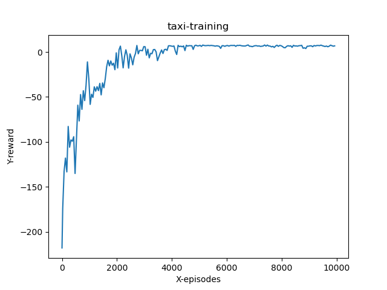
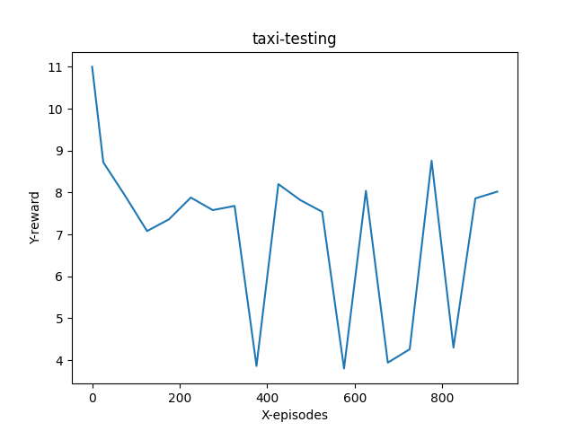
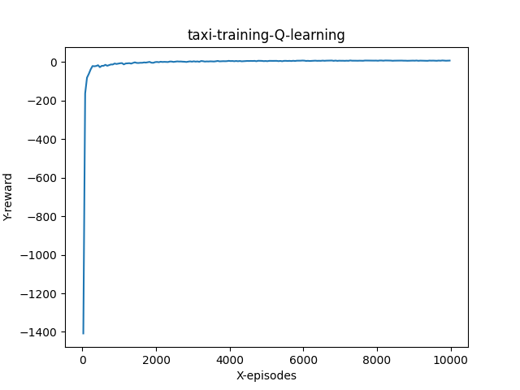
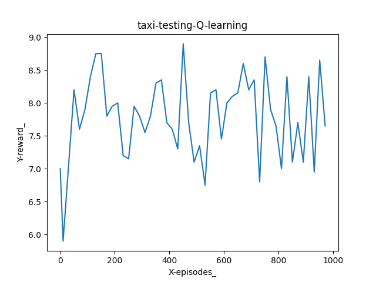
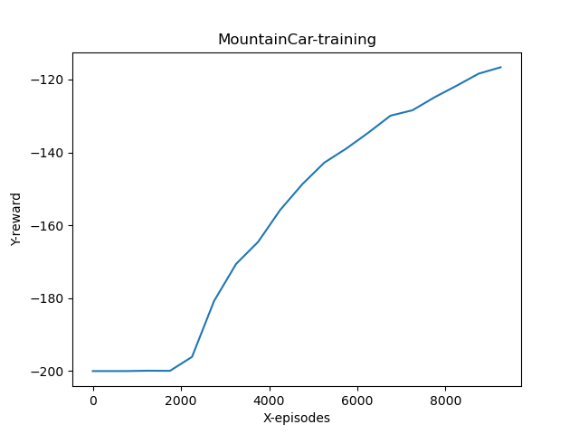
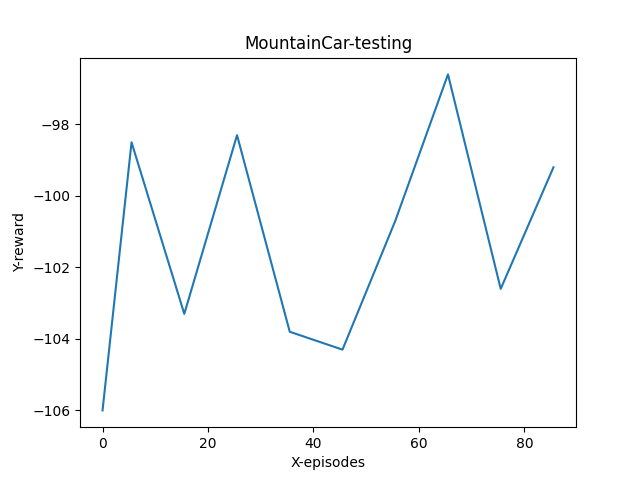

# Q-learning vs. Deep Q-learning on Taxi and MountainCar

This project trains reinforcement-learning agents on two
[Gymnasium](https://gymnasium.farama.org/) environments:

| Environment | State space | Methods |
|---|---|---|
| **Taxi-v3**: pick up a passenger on a 5×5 grid and drop them at their destination | discrete, 500 states | tabular **Q-learning** and **Deep Q-learning (DQN)** |
| **MountainCar-v0**: build up momentum to drive an underpowered car up a hill | continuous, `[position, velocity]` | **DQN** |

Each agent is compared against a uniform random policy. The full write-up is in
[report.pdf](report.pdf).

## Results

These are greedy-policy rewards over 1000 test episodes, from the pretrained models in [models/](models/)
(`seed=0`):

| Environment | Agent | Mean reward |
|---|---|---|
| Taxi-v3 | Random policy (valid actions only) | −186 |
| Taxi-v3 | Q-learning | **7.97** |
| Taxi-v3 | DQN | 6.62 |
| MountainCar-v0 | Random policy | −200 (never reaches the flag) |
| MountainCar-v0 | DQN | **−102.7** |

The plots from the report are in [results/](results/).

| | Training | Testing |
|---|---|---|
| Taxi, DQN |  |  |
| Taxi, Q-learning |  |  |
| MountainCar, DQN |  |  |

## Setup

You need Python ≥ 3.10. The pinned versions were tested on Python 3.14.

```bash
python -m venv .venv
source .venv/bin/activate          # Windows: .venv\Scripts\activate
pip install -r requirements.txt
```

> `gymnasium` is pinned to 1.2.2 on purpose: newer releases removed `Taxi-v3`.

## Usage

Run every command from the repository root. Each script has a `--help` option.

### Evaluate the pretrained models (reproduces the table above)

```bash
python src/q_learning_taxi.py test
python src/dqn_taxi.py test
python src/dqn_mountain_car.py test
python src/random_policy.py Taxi-v3
python src/random_policy.py MountainCar-v0
```

### Train from scratch

```bash
python src/q_learning_taxi.py train      # a few seconds
python src/dqn_taxi.py train             # 10 000 episodes, slow on CPU
python src/dqn_mountain_car.py train     # 10 000 episodes, slow on CPU
```

Then evaluate the model you just trained:

```bash
python src/dqn_taxi.py test --model runs/taxi_dqn.pth
python src/dqn_mountain_car.py test --model runs/mountaincar_dqn.pth
python src/q_learning_taxi.py test --model runs/taxi_q_table.csv
```

Common options:

| Option | Meaning | Default |
|---|---|---|
| `--episodes N` | number of episodes | 10000 (train) / 1000 (test) |
| `--seed S` | seed for Python, NumPy, PyTorch and the environment | `0` |
| `--model PATH` | checkpoint to write (train) or read (test) | `runs/…` (train) / `models/…` (test) |
| `--log-every N` | print progress every N episodes | 100 (500 for Q-learning) |
| `--alpha A` | Q-learning only: learning rate of the update | `1.0` |

Everything the scripts produce (checkpoints, Q-tables, plots) goes to `runs/`,
which git ignores. The shipped files in `models/` and `results/` are never
overwritten.

## Reproducibility

- All random sources are seeded from `--seed`: Python, NumPy, PyTorch, the
  agent's exploration RNG, the environment and its action space. Running the
  same command twice gives the same numbers.
- Library versions are pinned in [requirements.txt](requirements.txt).
- Everything runs on the CPU. The `device` argument of `DQNAgent` can move it to a GPU,
  but GPU kernels are not guaranteed to be bit-for-bit deterministic.
- If you retrain, expect numbers close to the table above, not identical
  ones: the pretrained models were trained without a fixed seed.

## Project structure

```
├── README.md
├── requirements.txt
├── report.pdf                  # project report
├── models/                     # pretrained models used in the report
│   ├── taxi_dqn.pth
│   ├── mountaincar_dqn.pth
│   └── taxi_q_table.csv        # 500 × 6 Q-table
├── results/                    # figures used in the report
└── src/
    ├── dqn.py                  # DeepQNetwork, ReplayBuffer, DQNAgent
    ├── common.py               # paths, seeding, plotting
    ├── dqn_taxi.py             # DQN on Taxi-v3
    ├── dqn_mountain_car.py     # DQN on MountainCar-v0
    ├── q_learning_taxi.py      # tabular Q-learning on Taxi-v3
    └── random_policy.py        # random-policy baseline
```

## Method

### Deep Q-Network ([src/dqn.py](src/dqn.py))

- **Network**: fully connected, `input → 128 → 128 → 128 → n_actions`, ReLU
  activations, linear output with one Q-value per action.
- **Experience replay**: transitions `(s, a, r, s', terminated)` go into a
  circular buffer. Each environment step trains on one random minibatch from it.
- **Target**: `r + γ · max_a' Q(s', a')`, with no bootstrapping from terminal
  states. One network produces both the prediction and the target (no
  separate target network), as in the report.
- **Loss / optimiser**: MSE, Adam.
- **Exploration**: ε-greedy with `ε ← max(ε_min, ε · decay)`.

Taxi states are integers. Before going into the network, they are decoded into
`[taxi_row, taxi_col, passenger_location, destination]`.

### Hyper-parameters

| | Taxi DQN | MountainCar DQN | Taxi Q-learning |
|---|---|---|---|
| Learning rate | 1e-3 | 1e-3 | α = 1.0 |
| γ | 0.99 | 0.99 | 0.99 |
| Batch size | 64 | 128 | – |
| Replay memory | 100 000 | 10 000 | – |
| ε start → min | 1.0 → 0.05 | 1.0 → 0.05 | 1.0 → 0.01 |
| ε decay | 0.99997 per **step** | 0.9997 per **episode** | 0.99997 per **step** |
| Training episodes | 10 000 | 10 000 | 10 000 |

These values come from the code that produced the pretrained models. A few
of them differ from the ones printed in the report: the report lists batch
size 128 and ε_min 0.01 for Taxi DQN, and ε decay 0.99997 and ε_min 0.01 for
MountainCar.
